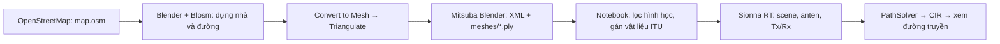

# Sionna Test — từ OpenStreetMap đến mô phỏng kênh vô tuyến

> **Lưu ý:** Repo đã bổ sung file OpenStreetMap gốc [map.osm](public/map.osm) và file Blender [test-Manhattan.blend](public/test-Manhattan.blend). Có thể dùng các file này để tiếp tục quy trình với scene mẫu; các bước bên dưới cũng hướng dẫn tạo scene cho khu vực mới.

Project dựng môi trường đô thị từ dữ liệu OpenStreetMap, xuất hình học từ Blender sang Mitsuba và dùng NVIDIA Sionna RT để tìm đường truyền giữa máy phát (Tx) và máy thu (Rx). Notebook [test.ipynb](test.ipynb) tính hệ số kênh phức và độ trễ của từng đường truyền ở tần số **3,5 GHz**.



Tên công cụ xuất scene là **Mitsuba**, add-on là **Mitsuba Blender**. Blosm phụ trách nhập dữ liệu bản đồ; Mitsuba Blender phụ trách xuất scene. Sionna RT dùng scene đó để mô phỏng truyền sóng. [Giới thiệu Sionna RT](https://nvlabs.github.io/sionna/v2.1.0/rt/tutorials/Introduction.html).

## 1. File và môi trường của project

```text
Sionna_test/
├── README.md
├── .python-version                 # Python 3.11
├── pyproject.toml                  # Khai báo dependency
├── uv.lock                         # Khóa phiên bản dependency
├── test.ipynb                      # Toàn bộ quy trình Python hiện tại
└── public/
    ├── map.osm                     # Dữ liệu OpenStreetMap gốc
    ├── test-Manhattan.blend         # File Blender của scene mẫu
    ├── test-Manhattan.xml           # Scene xuất từ Blender, 26 shape PLY
    ├── test-Manhattan-materials.xml # Scene sau xử lý, 23 shape PLY
    └── meshes/                     # 26 file hình học .ply
```

Repo hiện có dữ liệu OpenStreetMap gốc, file Blender, scene đã xuất và notebook. Khi tạo scene cho khu vực mới, nên lưu kèm file `.osm`, `.blend`, phạm vi tọa độ và phiên bản Blender/add-on để thuận tiện tái tạo.

Các phiên bản chính trong `uv.lock`:

| Thành phần | Phiên bản |
| --- | --- |
| Python được chọn trong `.python-version` | 3.11 |
| Sionna / Sionna RT | 2.2.0 / 2.2.0 |
| Mitsuba | 3.9.1 |
| Dr.Jit | 1.5.0 |
| JupyterLab | 4.6.4 |
| ipywidgets / pythreejs | 8.1.9 / 2.4.2 |

`pyproject.toml` cho phép Python từ 3.11 và khai báo các phiên bản tối thiểu; dùng `uv.lock` để tái tạo môi trường hiện tại. Blender có Python riêng: cài dependency vào `.venv` của project không đồng nghĩa đã cài chúng cho add-on trong Blender.

## 2. Lấy file `.osm` từ OpenStreetMap

1. Mở [OpenStreetMap](https://www.openstreetmap.org), tìm khu vực cần mô phỏng.
2. Chọn **Export**, khoanh vùng nhỏ bao quanh vị trí Tx/Rx và các công trình lân cận.
3. Xuất dữ liệu **OpenStreetMap XML**, lưu thành `map.osm`. Đây là dữ liệu bản đồ để Blosm đọc.
4. Nếu vùng quá lớn khiến export thất bại, thu nhỏ vùng hoặc dùng nguồn trích xuất như Overpass/Geofabrik. [Hướng dẫn export của OpenStreetMap](https://wiki.openstreetmap.org/wiki/Export).

Giữ lại file nguồn và phạm vi đã chọn. Scene của repo mang tên `test-Manhattan`, nhưng chỉ tên file chưa đủ để khôi phục chính xác phạm vi địa lý ban đầu.

## 3. Cài Blender, Blosm và Mitsuba Blender

Trước tiên, tải và cài **[Blender](https://www.blender.org/download/)**. Sau đó cài hai add-on Blosm và Mitsuba Blender bên trong Blender. Chọn gói add-on phù hợp với phiên bản Blender đang dùng; phần sửa lỗi bên dưới có ví dụ đường dẫn cho Blender **5.2** trên Windows.

### Blosm

Tải gói cài từ [thư mục Google Drive được chia sẻ](https://drive.google.com/drive/folders/10M3wN_anZPIwvFthPcGEjvzPF9ZByNf_?usp=sharing) hoặc liên kết của [dự án Blosm](https://github.com/vvoovv/blosm); bản cơ bản có chức năng nhập OpenStreetMap.

1. Giữ nguyên file ZIP. Trong Blender, mở **Edit → Preferences → Add-ons**, dùng **Install… / Install from Disk…** tùy phiên bản, rồi bật Blosm.
2. Trong cấu hình add-on, đặt thư mục lưu dữ liệu tải về bằng đường dẫn tuyệt đối.
3. Trong 3D Viewport, nhấn `N` để mở thanh bên và tìm tab **Blosm**. [Hướng dẫn cài Blosm](https://github.com/vvoovv/blosm/wiki/Documentation#installation).

### Mitsuba Blender

Tải ZIP từ [thư mục Google Drive được chia sẻ](https://drive.google.com/drive/folders/10M3wN_anZPIwvFthPcGEjvzPF9ZByNf_?usp=sharing) hoặc [Mitsuba Blender Releases](https://github.com/mitsuba-renderer/mitsuba-blender/releases). Chọn gói tương ứng với hệ điều hành và phiên bản Blender đang dùng.

- Với gói **extension** cho Blender 4.2 trở lên: **Edit → Preferences → Get Extensions → menu → Install from Disk…**, chọn ZIP và bật extension. Gói release mới có kèm dependency Mitsuba/Dr.Jit.
- Với gói **add-on cũ**: cài qua **Add-ons → Install…**, bật add-on; nếu có nút **Install dependencies using pip**, chạy bước đó trong cấu hình add-on.

**Lưu ý khi Install dependencies using pip thất bại:** Một số bản add-on cũ khóa Mitsuba ở `3.5.0` trong file `mitsuba-blender/__init__.py`. Nếu log báo không tìm thấy bản phù hợp với `mitsuba==3.5.0`, sửa phiên bản này thành **`3.6.0`**. [Mã nguồn khai báo phiên bản](https://github.com/mitsuba-renderer/mitsuba-blender/blob/v0.4.0/mitsuba-blender/__init__.py), [báo cáo lỗi dependency 3.5.0](https://github.com/mitsuba-renderer/mitsuba-blender/issues/125).

1. Mở file `__init__.py` ở thư mục gốc của **add-on Mitsuba Blender đã cài**, thường nằm trong `scripts/addons/mitsuba-blender/` của Blender.
2. Tìm dòng khai báo và sửa như sau:

   ```diff
   -DEPS_MITSUBA_VERSION = '3.5.0'
   +DEPS_MITSUBA_VERSION = '3.6.0'
   ```

3. Lưu file, đóng rồi mở lại Blender để nạp thay đổi.
4. Vào cấu hình Mitsuba Blender và bấm lại **Install dependencies using pip** (hoặc **Update dependencies**), rồi kiểm tra add-on khởi tạo thành công và có mục export Mitsuba.

Phiên bản sửa ở đây là dependency của add-on trong Python của Blender; môi trường mô phỏng của project vẫn dùng Mitsuba `3.9.1` theo `uv.lock`.

**Lưu ý khi đã sửa dependency nhưng vẫn không export được trên Blender 5.x:** Nếu gặp lỗi `ExportMitsuba.__init__() takes 1 positional argument but 2 were given`, mở file `io/__init__.py` của add-on. Với Blender 5.2 trên Windows và tài khoản `Admin`, đường dẫn là:

```text
C:\Users\Admin\AppData\Roaming\Blender Foundation\Blender\5.2\scripts\addons\mitsuba-blender\io\__init__.py
```

Trong class `ExportMitsuba`, thay phương thức `__init__` cũ bằng đoạn sau, giữ đúng thụt lề trong class:

```python
    def __init__(self, *args, **kwargs):
        super().__init__(*args, **kwargs)
        self.reset()
```

Lưu file, đóng rồi mở lại Blender và thử **File → Export → Mitsuba (.xml)**. Thay `Admin` và `5.2` theo tài khoản, phiên bản Blender đang dùng. Đoạn khởi tạo này cũng có trong [mã nguồn exporter Mitsuba Blender](https://github.com/mitsuba-renderer/mitsuba-blender/blob/master/mitsuba-blender/io/__init__.py).

Chọn hướng cài theo README của chính release tải về. Sau khi cài, kiểm tra mục xuất Mitsuba trong **File → Export**. [Tài liệu Mitsuba Blender](https://github.com/mitsuba-renderer/mitsuba-blender).

## 4. Nhập `.osm` và chuẩn bị hình học trong Blender

### Nhập bằng Blosm

1. Tạo scene làm việc, bỏ cube mặc định nếu không sử dụng.
2. Mở tab **Blosm**, chọn loại dữ liệu **OpenStreetMap**, nguồn **file** và trỏ tới `map.osm`.
3. Bật nhập **Buildings** và **Roads/Paths**, chọn **Import**. Nếu cần địa hình, nhập terrain trước và chọn nó làm bề mặt đặt đối tượng. [Nhập file OSM cục bộ](https://github.com/vvoovv/blosm/wiki/Documentation#openstreetmap-import-from-a-local-file).

Blosm dựng nhà từ thông tin chiều cao/số tầng; đường và lối đi có thể được tạo dưới dạng **Curve có profile tạo bề rộng**. Kiểm tra chiều cao công trình, bề rộng đường và cao độ sau khi nhập. [Các loại hình học Blosm tạo ra](https://github.com/vvoovv/blosm/wiki/Import-OpenStreetMap-%28.osm%29).

Giữ quy ước tên như `map_osm_buildings...`, `map_osm_roads...`, `map_osm_paths...`: notebook phân loại bằng chuỗi `building`, `road`, `path` trong ID hoặc tên file mesh. Đối tượng đổi thành tên chung như `Cube.001` có thể bị loại ở bước xử lý XML.

### Convert to Mesh và Triangulate

Sionna RT 2.2.0 kiểm tra hình học đầu vào là **triangle mesh**. Vì vậy cần chuyển Curve/surface thành mesh và bảo đảm các mặt là tam giác. Đây là yêu cầu hình học của bộ nạp scene Sionna RT, không phải một chế độ render ảnh riêng của card NVIDIA. [Mã nguồn kiểm tra scene](https://nvlabs.github.io/sionna/_modules/sionna/rt/scene.html).

Thực hiện trên bản scene đã lưu dự phòng:

1. Trong **Object Mode**, chọn các đối tượng nhà và đường cần xuất; bỏ chọn camera, đèn và các đối tượng phụ trợ.
2. Chọn **Object → Convert → Mesh**; có thể dùng `F3`, tìm **Convert Mesh**. Với đường, kiểm tra Curve đã có bề rộng/profile trước khi chuyển: một đường chỉ có cạnh sẽ chưa tạo được bề mặt phản xạ.
3. Với các mesh đã chọn, vào **Edit Mode**, nhấn `A` chọn toàn bộ hình học, sau đó `Ctrl+T` (**Face → Triangulate Faces**) để chia mặt thành tam giác. [Thao tác Triangulate trong Blender](https://docs.blender.org/manual/en/latest/modeling/meshes/editing/face/triangulate_faces.html).
4. Kiểm tra hướng mặt bằng **Face Orientation**; sửa normal sai và loại mặt suy biến nếu có. Trở về **Object Mode**.
5. Kiểm tra tỷ lệ kích thước, trục đứng và vị trí tương đối giữa nhà/đường. Quy ước làm việc cho project là tọa độ cục bộ tính bằng **mét**, trục `Z` biểu diễn cao độ.

**Convert to Mesh** tạo dữ liệu mesh từ đối tượng; **Triangulate** chia các mặt của mesh thành tam giác. Đổi tên file hoặc sửa `type="..."` trong XML không thực hiện hai phép chuyển đổi hình học này.

## 5. Xuất XML và mesh bằng Mitsuba Blender

Mở **File → Export → Mitsuba (.xml)**, lưu vào `public/test-Manhattan.xml` nếu muốn dùng nguyên đường dẫn của notebook. Khi thay scene mẫu, nên xuất ra tên mới trước để giữ bản gốc.

Các tùy chọn cần kiểm tra khi exporter có hỗ trợ:

| Tùy chọn | Cách dùng cho notebook này |
| --- | --- |
| Selection Only | Bật nếu đã chọn đủ nhà và đường cần xuất |
| Split File | Tắt: cell xử lý hiện đọc trực tiếp `<shape>` ở cấp gốc XML |
| Export IDs | Có thể bật để giữ tên đối tượng, giúp nhận diện nhóm |
| Forward/Up | Kiểm tra scene xuất ra vẫn có hướng và tỷ lệ phù hợp với Tx/Rx |

Tên tùy chọn tùy release; xem [hướng dẫn exporter](https://github.com/mitsuba-renderer/mitsuba-blender/wiki/Exporting-a-Blender-scene).

Đầu ra cần giữ cùng nhau:

```text
public/
├── test-Manhattan.xml
└── meshes/
    ├── map_osm_buildings-wall.ply
    ├── map_osm_buildings-roof.ply
    ├── map_osm_roads_primary.ply
    └── ...
```

Ví dụ tham chiếu hình học trong XML hiện tại:

```xml
<shape type="ply" id="elm__18" name="elm__18">
  <string name="filename" value="meshes/map_osm_buildings-wall.ply" />
  <boolean name="face_normals" value="true" />
  <ref name="bsdf" id="mat-wall" />
</shape>
```

`meshes/...` được tìm tương đối với file scene. Khi sao chép sang máy khác, mang theo cả XML và thư mục `meshes`. File XML đơn lẻ không chứa toàn bộ hình học.

## 6. Cài môi trường và mở notebook

Cài [uv](https://docs.astral.sh/uv/getting-started/installation/), mở terminal tại thư mục gốc project rồi chạy:

```bash
uv sync --locked
uv run --locked jupyter lab test.ipynb
```

Trong JupyterLab, dùng kernel của `.venv`. Nếu dùng VS Code, mở `test.ipynb` và chọn interpreter `.venv/bin/python` trên Linux hoặc `.venv\Scripts\python.exe` trên Windows. Thư mục làm việc phải là gốc project để các đường dẫn `public/...` đúng.

Cell đầu notebook chọn backend CUDA trước khi import Sionna RT:

```python
import mitsuba as mi
mi.set_variant("cuda_ad_mono_polarized")
```

Để chạy nguyên notebook, máy cần GPU NVIDIA và driver hoạt động. Có thể kiểm tra bằng `nvidia-smi`, sau đó kiểm tra backend trong môi trường project:

```bash
uv run --locked python -c 'import mitsuba as mi; mi.set_variant("cuda_ad_mono_polarized"); print(mi.variant())'
```

Sionna RT cài trong project cũng hỗ trợ backend CPU qua LLVM. Nếu máy không dùng được CUDA, đổi dòng chọn variant thành dòng dưới đây, rồi **restart kernel và chạy lại từ đầu**; LLVM phải khả dụng trong môi trường:

```python
mi.set_variant("llvm_ad_mono_polarized")
```

Notebook hiện chọn CUDA cố định, chưa tự fallback sang CPU.

## 7. Từ scene Blender đến scene có vật liệu vô tuyến

Chạy notebook từ trên xuống. Cell xử lý XML ngay sau cell import đọc `public/test-Manhattan.xml` và ghi lại `public/test-Manhattan-materials.xml`.

Cell này thực hiện:

1. Tạo scene XML mới và hai ID vật liệu ITU.
2. Duyệt các `<shape>` trực tiếp trong XML gốc; chấp nhận loại `ply`, `obj`, `serialized`. Đây là kiểm tra loại khai báo, chưa thay cho kiểm tra hình học bên trong file mesh.
3. Phân nhóm theo ID và tên file, sao chép shape được chọn cùng đường dẫn và transform.
4. Bỏ BSDF, tham chiếu vật liệu và emitter cũ trong shape; gắn vật liệu mới. Camera, đèn và cấu hình render cấp scene không được chép sang scene mới.

| Chuỗi nhận diện trong ID/tên file | ID trong XML mới | Vật liệu Sionna | Số mesh của scene mẫu |
| --- | --- | --- | --- |
| `building` | `mat-itu_brick` | `brick` | 15 |
| `road` hoặc `path` | `mat-itu_asphalt_concrete` | `asphalt_concrete` | 8 |
| Không khớp các nhóm trên | Bỏ qua | — | 3 |

Ba mesh bị bỏ qua ở scene hiện tại là `map_osm_areas_pedestrian.ply`, `map_osm_vegetation.ply`, `map_osm_water.ply`. Như vậy, khu vực pedestrian mang tên `areas_pedestrian` **không** được giữ như mesh `roads_pedestrian`.

Vật liệu màu/texture trong Blender phục vụ hiển thị. Ở đây các ID `mat-itu_...` được bộ nạp Sionna chuyển thành vật liệu vô tuyến ITU. Toàn bộ nhà, kể cả mái, đang được giả định là gạch; toàn bộ đường/lối đi là asphalt concrete. Đây là giả định của mô hình, chưa phải vật liệu khảo sát từng công trình.

Output của cell với dữ liệu hiện tại:

```text
Số mesh theo nhóm: {'buildings': 15, 'roads': 8}
Đối tượng bỏ qua: ['elm__34 meshes/map_osm_areas_pedestrian.ply', 'elm__52 meshes/map_osm_vegetation.ply', 'elm__54 meshes/map_osm_water.ply']
File mới: public/test-Manhattan-materials.xml
```

Cell này **không chuyển Curve sang mesh, không triangulate và không sửa file PLY**. Những việc đó phải hoàn tất ở Blender. Nếu muốn giữ terrain, cây hoặc mặt nước, cần mở rộng quy tắc lọc và gán vật liệu tương ứng trong notebook.

Tiếp theo nạp scene và kiểm tra vật liệu:

```python
scene = load_scene("public/test-Manhattan-materials.xml")
for name, obj in scene.objects.items():
    print(name, "→", obj.radio_material.itu_type)
scene.preview(point_picker=True)
```

`load_scene()` mặc định gộp mesh cùng vật liệu, nên scene mẫu có thể chỉ hiện hai object `no-name-1`, `no-name-2` dù XML có 23 shape. Khi cần kiểm tra riêng từng mesh, có thể nạp bằng `load_scene(..., merge_shapes=False)`.

## 8. Đặt tần số, anten và Tx/Rx

Các cell tiếp theo cấu hình một anten cho mỗi phía:

```python
scene.frequency = 3.5e9

scene.tx_array = PlanarArray(
    num_rows=1, num_cols=1,
    vertical_spacing=0.5, horizontal_spacing=0.5,
    pattern="iso", polarization="V",
)
scene.rx_array = PlanarArray(
    num_rows=1, num_cols=1,
    vertical_spacing=0.5, horizontal_spacing=0.5,
    pattern="iso", polarization="V",
)

scene.add(Transmitter(name="tx", position=[-110.653, -73.533, 5.800 + 1.5]))
scene.add(Receiver(name="rx", position=[-23.614, 136.679, 5.800 + 1.5]))
```

`pattern="iso"` chọn mẫu anten đẳng hướng; `polarization="V"` là phân cực đứng. Khoảng cách phần tử được tính theo bước sóng, nhưng với mảng 1×1 chưa có khoảng cách giữa nhiều phần tử.

**`position=[x, y, z]` là tọa độ Cartesian cục bộ, đơn vị mét.** Tiêu đề cell `Init latitude & longtitude for each station` trong notebook hiện chưa diễn đạt đúng dữ liệu truyền vào. Các số này không phải kinh độ/vĩ độ.

Cả Tx và Rx của ví dụ có `z = 7.3 m`. Biểu thức `5.800 + 1.5` chỉ có nghĩa anten cao 1,5 m trên bề mặt nếu cao độ bề mặt tại vị trí đó thực sự là 5,8 m. Dùng point picker trong preview để lấy tọa độ bề mặt, sau đó cộng chiều cao anten. Với bản đồ mới, phải chọn lại cả `x`, `y`, `z`; muốn đặt từ GPS cần phép chuyển tọa độ cùng hệ quy chiếu/gốc với scene.

## 9. Tìm đường truyền và lấy CIR

Notebook dùng API `PathSolver` của Sionna RT 2.2.0:

```python
solver = PathSolver()
paths = solver(
    scene=scene,
    max_depth=3,
    los=True,
    specular_reflection=True,
    diffuse_reflection=False,
    refraction=False,
    seed=42,
)
```

Cấu hình xét đường trực tiếp khi không bị chắn và phản xạ gương, với độ sâu tương tác tối đa 3. Phản xạ khuếch tán và khúc xạ đang tắt; nhiễu xạ cũng tắt theo mặc định của phiên bản này. `los=True` cho phép tìm LoS, không bảo đảm mọi vị trí Tx/Rx đều có LoS.

Lấy đáp ứng xung kênh (CIR):

```python
a, tau = paths.cir(normalize_delays=False, out_type="numpy")

# Rx 0, anten Rx 0, Tx 0, anten Tx 0, mọi path, thời điểm 0
coefficients = a[0, 0, 0, 0, :, 0]
delays = tau[0, 0, :]
valid = (delays >= 0) & (np.abs(coefficients) > 0)

print("Số đường truyền tìm được:", np.count_nonzero(valid))
for index in np.flatnonzero(valid):
    print(
        f"Path {index}: "
        f"delay={delays[index] * 1e9:.2f} ns, "
        f"|a|={abs(coefficients[index]):.3e}"
    )

scene.preview(paths=paths)
```

- `a` là hệ số kênh phức; `abs(a)` là độ lớn hệ số, không phải công suất thu tính bằng dBm.
- `tau` có đơn vị giây; nhân `1e9` để hiển thị nanosecond.
- `normalize_delays=False` giữ độ trễ truyền sóng thay vì đưa đường đến sớm nhất về mốc 0.
- Cách lấy `tau[0, 0, :]` phù hợp với `synthetic_array=True`, mặc định đang dùng. Nếu đổi cấu hình mảng, cần kiểm tra lại shape trước khi lập chỉ mục.

Với scene mẫu và cấu hình trên, lần kiểm tra phần tính toán ngày **18/10/2026** trả về **10 đường truyền hợp lệ**, `a.shape = (1, 1, 1, 1, 10, 1)` và `tau.shape = (1, 1, 10)`. Một đường có độ trễ khoảng `758.92 ns` và `|a| ≈ 2.996e-05`. Thứ tự path có thể khác giữa các lần chạy; kết quả này gắn với scene, vật liệu và phiên bản hiện tại.

Phần tính toán đã được chạy lại bằng backend CUDA. Các thao tác Blender và giao diện preview tương tác chưa được kiểm chứng lại trong lần viết tài liệu này.

## 10. Lỗi thường gặp và cách xử lý

| Hiện tượng | Điểm cần kiểm tra |
| --- | --- |
| Không thấy tab Blosm | Kiểm tra add-on đã bật; nhấn `N` trong 3D Viewport; kiểm tra thư mục dữ liệu |
| Không thấy mục export Mitsuba | Kiểm tra gói add-on/extension phù hợp Blender và dependency trong Python của Blender |
| `Only triangle meshes are supported` | Kiểm tra loại shape được export; chuyển hình học sang mesh và triangulate trong Blender, rồi xuất lại |
| `Còn hình học không hỗ trợ` | Cell XML gặp loại ngoài `ply`, `obj`, `serialized`; xử lý hình học ở Blender trước |
| `Chưa nhận diện đủ nhà và đường` | Kiểm tra tên ID/file có `building`, `road`, `path`; kiểm tra đã xuất đủ cả hai nhóm và tắt Split File |
| Thiếu file XML/PLY | Chạy từ gốc project; giữ cấu trúc XML và `meshes/`; kiểm tra đường dẫn `filename` trong XML |
| Lỗi vật liệu khi load scene | Chạy cell tạo `test-Manhattan-materials.xml`, rồi nạp đúng file đã xử lý |
| CUDA/variant không khởi tạo được | Kiểm tra GPU/driver và kernel; nếu chuyển LLVM thì restart kernel trước khi chạy lại |
| Preview trắng hoặc chỉ hiện chuỗi widget | Dùng kernel `.venv`, kiểm tra widget JupyterLab và WebGL trình duyệt; khởi động lại Jupyter sau khi cài dependency |
| Không có đường truyền | Kiểm tra Tx/Rx nằm trong vùng scene, không nằm trong nhà/dưới mặt đường; kiểm tra đơn vị và cấu hình tương tác |
| Chạy lại cell thêm Tx/Rx báo trùng tên | Nạp lại scene hoặc restart kernel rồi chạy từ đầu |
| Thêm terrain nhưng không thấy trong mô phỏng | Bộ lọc XML hiện chỉ giữ nhà và đường/lối đi; bổ sung nhóm và vật liệu cho terrain |

Khi dùng khu vực mới: lưu nguồn OSM/Blender, xuất XML cùng mesh, cập nhật đường dẫn đầu vào/đầu ra trong notebook, kiểm tra số mesh từng nhóm, đặt lại Tx/Rx rồi chạy toàn bộ quy trình.
