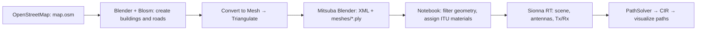

# Sionna Test — from OpenStreetMap to Radio Channel Simulation

> **Note:** The repository includes the original OpenStreetMap file [map.osm](public/map.osm) and the Blender file [test-Manhattan.blend](public/test-Manhattan.blend). Use these files to continue working with the sample scene. The steps below also explain how to create a scene for a different area.

This project builds an urban environment from OpenStreetMap data, exports geometry from Blender to Mitsuba, and uses NVIDIA Sionna RT to find propagation paths between a transmitter (Tx) and a receiver (Rx). The [test.ipynb](test.ipynb) notebook computes the complex channel coefficients and delays of individual paths at **3.5 GHz**.



**Mitsuba** is the renderer, and **Mitsuba Blender** is the add-on used to export the scene. Blosm imports map data; Mitsuba Blender exports the scene; Sionna RT uses that scene to simulate radio propagation. See the [Sionna RT introduction](https://nvlabs.github.io/sionna/v2.1.0/rt/tutorials/Introduction.html).

## 1. Project Files and Environment

```text
Sionna_test/
├── README.md
├── .python-version                 # Python 3.11
├── pyproject.toml                  # Dependency declarations
├── uv.lock                         # Locked dependency versions
├── test.ipynb                      # Current Python workflow
└── public/
    ├── map.osm                     # Original OpenStreetMap data
    ├── test-Manhattan.blend         # Blender file for the sample scene
    ├── test-Manhattan.xml           # Blender export: 26 PLY shapes
    ├── test-Manhattan-materials.xml # Processed scene: 23 PLY shapes
    └── meshes/                     # 26 .ply geometry files
```

The repository contains the original OpenStreetMap data, the Blender file, the exported scene, and the notebook. For a new area, save the `.osm` and `.blend` files, geographic bounds, and Blender/add-on versions so the scene can be reproduced.

Main versions in `uv.lock`:

| Component | Version |
| --- | --- |
| Python selected in `.python-version` | 3.11 |
| Sionna / Sionna RT | 2.2.0 / 2.2.0 |
| Mitsuba | 3.9.1 |
| Dr.Jit | 1.5.0 |
| JupyterLab | 4.6.4 |
| ipywidgets / pythreejs | 8.1.9 / 2.4.2 |

`pyproject.toml` allows Python 3.11 or later and declares minimum dependency versions. Use `uv.lock` to reproduce the current environment. Blender has its own Python interpreter: installing dependencies into the project's `.venv` does not install them for the Blender add-on.

## 2. Download an `.osm` File from OpenStreetMap

1. Open [OpenStreetMap](https://www.openstreetmap.org) and find the area to simulate.
2. Select **Export** and mark a small area containing the Tx/Rx locations and nearby buildings.
3. Export **OpenStreetMap XML** data and save it as `map.osm`. Blosm reads this map data.
4. If the export fails because the area is too large, reduce the area or use an extract provider such as Overpass/Geofabrik. See the [OpenStreetMap export guide](https://wiki.openstreetmap.org/wiki/Export).

Keep the source file and the selected bounds. The scene in this repository is named `test-Manhattan`, but its filename alone does not identify its exact geographic extent.

## 3. Install Blender, Blosm, and Mitsuba Blender

First, download and install **[Blender](https://www.blender.org/download/)**. Then install the Blosm and Mitsuba Blender add-ons inside Blender. Choose add-on packages that match your Blender version. The troubleshooting instructions below include an example path for Blender **5.2** on Windows.

### Blosm

Download the installation package from the [shared Google Drive folder](https://drive.google.com/drive/folders/10M3wN_anZPIwvFthPcGEjvzPF9ZByNf_?usp=sharing) or the links provided by the [Blosm project](https://github.com/vvoovv/blosm). The basic version supports OpenStreetMap imports.

1. Keep the ZIP archive intact. In Blender, open **Edit → Preferences → Add-ons**, use **Install… / Install from Disk…**, depending on your version, and enable Blosm.
2. In the add-on preferences, set an absolute path for the downloaded data directory.
3. Press `N` in the 3D Viewport to open the sidebar and locate the **Blosm** tab. See the [Blosm installation guide](https://github.com/vvoovv/blosm/wiki/Documentation#installation).

### Mitsuba Blender

Download the ZIP from the [shared Google Drive folder](https://drive.google.com/drive/folders/10M3wN_anZPIwvFthPcGEjvzPF9ZByNf_?usp=sharing) or [Mitsuba Blender Releases](https://github.com/mitsuba-renderer/mitsuba-blender/releases). Choose a package matching your operating system and Blender version.

- For **extension** packages targeting Blender 4.2 or later: open **Edit → Preferences → Get Extensions → menu → Install from Disk…**, select the ZIP, and enable the extension. Newer release packages bundle the Mitsuba/Dr.Jit dependencies.
- For **legacy add-on** packages: install through **Add-ons → Install…** and enable the add-on. If its preferences include **Install dependencies using pip**, run that step.

**If Install dependencies using pip fails:** Some older add-on versions pin Mitsuba to `3.5.0` in `mitsuba-blender/__init__.py`. If the log reports that no matching distribution is available for `mitsuba==3.5.0`, change this version to **`3.6.0`**. See the [dependency version declaration](https://github.com/mitsuba-renderer/mitsuba-blender/blob/v0.4.0/mitsuba-blender/__init__.py) and the [Mitsuba 3.5.0 dependency issue](https://github.com/mitsuba-renderer/mitsuba-blender/issues/125).

1. Open `__init__.py` in the root directory of the **installed Mitsuba Blender add-on**, usually under Blender's `scripts/addons/mitsuba-blender/` directory.
2. Find and update the version declaration:

   ```diff
   -DEPS_MITSUBA_VERSION = '3.5.0'
   +DEPS_MITSUBA_VERSION = '3.6.0'
   ```

3. Save the file and restart Blender to load the change.
4. Open the Mitsuba Blender preferences and click **Install dependencies using pip** again (or **Update dependencies**). Check that the add-on initializes successfully and the Mitsuba export option appears.

This change applies to the add-on dependency in Blender's Python environment. The project's simulation environment uses Mitsuba `3.9.1`, as locked in `uv.lock`.

**If export still fails on Blender 5.x after fixing the dependency:** If you encounter `ExportMitsuba.__init__() takes 1 positional argument but 2 were given`, open the add-on's `io/__init__.py` file. For Blender 5.2 on Windows with the `Admin` account, the path is:

```text
C:\Users\Admin\AppData\Roaming\Blender Foundation\Blender\5.2\scripts\addons\mitsuba-blender\io\__init__.py
```

Inside the `ExportMitsuba` class, replace the existing `__init__` method with the following, keeping the indentation within the class:

```python
    def __init__(self, *args, **kwargs):
        super().__init__(*args, **kwargs)
        self.reset()
```

Save the file, restart Blender, and try **File → Export → Mitsuba (.xml)** again. Replace `Admin` and `5.2` with your account name and Blender version. This constructor also appears in the [Mitsuba Blender exporter source](https://github.com/mitsuba-renderer/mitsuba-blender/blob/master/mitsuba-blender/io/__init__.py).

Follow the installation instructions in the README for the release you download. After installation, check for Mitsuba under **File → Export**. See the [Mitsuba Blender documentation](https://github.com/mitsuba-renderer/mitsuba-blender).

## 4. Import `.osm` and Prepare Geometry in Blender

### Import with Blosm

1. Create a working scene and remove the default cube if it is not needed.
2. Open the **Blosm** tab, select **OpenStreetMap** as the data type and **file** as the source, then select `map.osm`.
3. Enable **Buildings** and **Roads/Paths**, then select **Import**. If terrain is needed, import it first and select it as the surface for placing objects. See [importing a local OSM file](https://github.com/vvoovv/blosm/wiki/Documentation#openstreetmap-import-from-a-local-file).

Blosm builds buildings from height/floor information. Roads and paths may be created as **curves with a profile that gives them width**. Check building heights, road widths, and elevations after import. See the [geometry types generated by Blosm](https://github.com/vvoovv/blosm/wiki/Import-OpenStreetMap-%28.osm%29).

Keep names such as `map_osm_buildings...`, `map_osm_roads...`, and `map_osm_paths...`: the notebook classifies shapes by searching for `building`, `road`, and `path` in their IDs or mesh filenames. Objects renamed to generic names such as `Cube.001` may be excluded during XML processing.

### Convert to Mesh and Triangulate

Sionna RT 2.2.0 checks that input geometry is a **triangle mesh**. Convert curves/surfaces to meshes and ensure their faces are triangles. This is a geometry requirement of the Sionna RT scene loader, rather than a separate NVIDIA image-rendering mode. See the [scene validation source](https://nvlabs.github.io/sionna/_modules/sionna/rt/scene.html).

Save a backup of the scene before proceeding:

1. In **Object Mode**, select the buildings and roads to export. Deselect cameras, lights, and helper objects.
2. Select **Object → Convert → Mesh**, or press `F3` and search for **Convert Mesh**. For roads, check that the curves have width/a profile before conversion: edges alone do not provide a reflecting surface.
3. With the meshes selected, enter **Edit Mode**, press `A` to select all geometry, then press `Ctrl+T` (**Face → Triangulate Faces**) to split the faces into triangles. See [Triangulate Faces in Blender](https://docs.blender.org/manual/en/latest/modeling/meshes/editing/face/triangulate_faces.html).
4. Use **Face Orientation** to inspect face directions. Correct normals and remove degenerate faces where necessary, then return to **Object Mode**.
5. Check scale, the vertical axis, and the relative positions of buildings and roads. This project uses local coordinates in **meters**, with `Z` representing elevation.

**Convert to Mesh** creates mesh data from an object; **Triangulate** splits mesh faces into triangles. Renaming a file or editing `type="..."` in XML does not perform either geometry conversion.

## 5. Export XML and Meshes with Mitsuba Blender

Open **File → Export → Mitsuba (.xml)** and save to `public/test-Manhattan.xml` to use the notebook's existing path. When replacing the sample scene, export under a new name first to preserve the original.

Check these settings when supported by your exporter:

| Option | Setting for this notebook |
| --- | --- |
| Selection Only | Enable after selecting all buildings and roads to export |
| Split File | Disable: the processing cell currently reads `<shape>` elements directly under the XML root |
| Export IDs | Optionally enable to preserve object names and help identify groups |
| Forward/Up | Check that the exported orientation and scale agree with the Tx/Rx coordinates |

Option names vary by release. See the [exporter guide](https://github.com/mitsuba-renderer/mitsuba-blender/wiki/Exporting-a-Blender-scene).

Keep these output files together:

```text
public/
├── test-Manhattan.xml
└── meshes/
    ├── map_osm_buildings-wall.ply
    ├── map_osm_buildings-roof.ply
    ├── map_osm_roads_primary.ply
    └── ...
```

Example geometry reference from the current XML:

```xml
<shape type="ply" id="elm__18" name="elm__18">
  <string name="filename" value="meshes/map_osm_buildings-wall.ply" />
  <boolean name="face_normals" value="true" />
  <ref name="bsdf" id="mat-wall" />
</shape>
```

`meshes/...` is resolved relative to the scene file. When copying the scene to another machine, include both the XML and the `meshes` directory. The XML file alone does not contain all geometry.

## 6. Set Up the Environment and Open the Notebook

Install [uv](https://docs.astral.sh/uv/getting-started/installation/), open a terminal at the project root, and run:

```bash
uv sync --locked
uv run --locked jupyter lab test.ipynb
```

In JupyterLab, use the kernel from `.venv`. In VS Code, open `test.ipynb` and select `.venv/bin/python` on Linux or `.venv\Scripts\python.exe` on Windows. The working directory must be the project root so that `public/...` paths resolve correctly.

The first notebook cell selects the CUDA backend before importing Sionna RT:

```python
import mitsuba as mi
mi.set_variant("cuda_ad_mono_polarized")
```

Running the notebook unchanged requires an NVIDIA GPU and a working driver. Check with `nvidia-smi`, then test the backend in the project environment:

```bash
uv run --locked python -c 'import mitsuba as mi; mi.set_variant("cuda_ad_mono_polarized"); print(mi.variant())'
```

The installed Sionna RT version also supports a CPU backend through LLVM. If CUDA is unavailable, change the variant selection to the line below, then **restart the kernel and rerun from the beginning**. LLVM must be available in the environment:

```python
mi.set_variant("llvm_ad_mono_polarized")
```

The notebook currently selects CUDA explicitly and does not automatically fall back to the CPU.

## 7. Convert the Blender Export to a Scene with Radio Materials

Run the notebook from top to bottom. The XML processing cell immediately after the import cell reads `public/test-Manhattan.xml` and writes `public/test-Manhattan-materials.xml`.

This cell:

1. Creates a new scene XML and two ITU material IDs.
2. Iterates over `<shape>` elements directly under the original XML root, accepting `ply`, `obj`, and `serialized` types. This checks the declared type; it does not validate the geometry inside each mesh file.
3. Groups shapes by ID and filename, copying selected shapes with their paths and transforms.
4. Removes existing BSDFs, material references, and emitters inside each shape, then assigns the new material. Scene-level cameras, lights, and rendering settings are not copied.

| Matching text in ID/filename | New XML material ID | Sionna material | Sample mesh count |
| --- | --- | --- | --- |
| `building` | `mat-itu_brick` | `brick` | 15 |
| `road` or `path` | `mat-itu_asphalt_concrete` | `asphalt_concrete` | 8 |
| No match | Skipped | — | 3 |

The three skipped meshes are `map_osm_areas_pedestrian.ply`, `map_osm_vegetation.ply`, and `map_osm_water.ply`. Consequently, the pedestrian area named `areas_pedestrian` is excluded, while `roads_pedestrian` is retained.

Blender colors and textures control appearance. Here, the Sionna loader converts `mat-itu_...` IDs into ITU radio materials. All buildings, including roofs, are modeled as brick, and all roads/paths as asphalt concrete. These are modeling assumptions rather than surveyed materials for each structure.

For the current data, the cell produces the following output, with its labels translated into English here:

```text
Mesh counts by group: {'buildings': 15, 'roads': 8}
Skipped objects: ['elm__34 meshes/map_osm_areas_pedestrian.ply', 'elm__52 meshes/map_osm_vegetation.ply', 'elm__54 meshes/map_osm_water.ply']
Output file: public/test-Manhattan-materials.xml
```

This cell **does not convert curves to meshes, triangulate faces, or modify PLY files**. Complete those steps in Blender. To retain terrain, vegetation, or water, extend the filtering rules and assign appropriate radio materials in the notebook.

Next, load the scene and inspect its materials:

```python
scene = load_scene("public/test-Manhattan-materials.xml")
for name, obj in scene.objects.items():
    print(name, "→", obj.radio_material.itu_type)
scene.preview(point_picker=True)
```

By default, `load_scene()` merges meshes that share a material. The sample scene may therefore show only two objects, `no-name-1` and `no-name-2`, even though the XML contains 23 shapes. To inspect meshes individually, use `load_scene(..., merge_shapes=False)`.

## 8. Configure Frequency, Antennas, and Tx/Rx

The next cells configure one antenna at each end:

```python
scene.frequency = 3.5e9

scene.tx_array = PlanarArray(
    num_rows=1, num_cols=1,
    vertical_spacing=0.5, horizontal_spacing=0.5,
    pattern="iso", polarization="V",
)
scene.rx_array = PlanarArray(
    num_rows=1, num_cols=1,
    vertical_spacing=0.5, horizontal_spacing=0.5,
    pattern="iso", polarization="V",
)

scene.add(Transmitter(name="tx", position=[-110.653, -73.533, 5.800 + 1.5]))
scene.add(Receiver(name="rx", position=[-23.614, 136.679, 5.800 + 1.5]))
```

`pattern="iso"` selects an isotropic antenna pattern; `polarization="V"` specifies vertical polarization. Element spacing is expressed in wavelengths, although a 1×1 array has no spacing between multiple elements.

**`position=[x, y, z]` uses local Cartesian coordinates in meters.** The notebook heading `Init latitude & longtitude for each station` does not accurately describe these values: they are not latitude/longitude.

Both Tx and Rx in this example have `z = 7.3 m`. The expression `5.800 + 1.5` places an antenna 1.5 m above the surface only if the local surface elevation is actually 5.8 m. Use the preview's point picker to obtain a surface position, then add the antenna height. For a new map, select new `x`, `y`, and `z` values. Placing devices from GPS coordinates requires a conversion using the same coordinate system and origin as the scene.

## 9. Find Propagation Paths and Extract the CIR

The notebook uses the Sionna RT 2.2.0 `PathSolver` API:

```python
solver = PathSolver()
paths = solver(
    scene=scene,
    max_depth=3,
    los=True,
    specular_reflection=True,
    diffuse_reflection=False,
    refraction=False,
    seed=42,
)
```

This configuration considers unobstructed direct paths and specular reflections, with a maximum interaction depth of 3. Diffuse reflection and refraction are disabled; diffraction is also disabled by default in this version. `los=True` enables the search for LoS paths but does not guarantee that the Tx/Rx locations have line of sight.

Extract the channel impulse response (CIR):

```python
a, tau = paths.cir(normalize_delays=False, out_type="numpy")

# Rx 0, Rx antenna 0, Tx 0, Tx antenna 0, all paths, time step 0
coefficients = a[0, 0, 0, 0, :, 0]
delays = tau[0, 0, :]
valid = (delays >= 0) & (np.abs(coefficients) > 0)

print("Number of paths found:", np.count_nonzero(valid))
for index in np.flatnonzero(valid):
    print(
        f"Path {index}: "
        f"delay={delays[index] * 1e9:.2f} ns, "
        f"|a|={abs(coefficients[index]):.3e}"
    )

scene.preview(paths=paths)
```

- `a` contains complex channel coefficients; `abs(a)` is their magnitude, not received power in dBm.
- `tau` is in seconds; multiply by `1e9` to display nanoseconds.
- `normalize_delays=False` preserves propagation delays instead of shifting the earliest arrival to zero.
- Indexing with `tau[0, 0, :]` matches `synthetic_array=True`, the current default. If you change the array configuration, inspect the output shapes before indexing.

With the sample scene and configuration above, the computation checked on **18 October 2026** returned **10 valid propagation paths**, with `a.shape = (1, 1, 1, 1, 10, 1)` and `tau.shape = (1, 1, 10)`. One path had a delay of approximately `758.92 ns` and `|a| ≈ 2.996e-05`. Path order may vary between runs; these results apply to the current scene, materials, and dependency versions.

The computation was rerun using the CUDA backend. Blender operations and the interactive preview interface were not revalidated during the documentation update.

## 10. Troubleshooting

| Symptom | What to check |
| --- | --- |
| Blosm tab is missing | Enable the add-on, press `N` in the 3D Viewport, and check the data directory |
| Mitsuba export option is missing | Check add-on/extension compatibility with Blender and dependencies in Blender's Python |
| `Only triangle meshes are supported` | Check exported shape types; convert geometry to meshes and triangulate in Blender, then export again |
| Unsupported geometry error (`Còn hình học không hỗ trợ`) | The XML cell found a type other than `ply`, `obj`, or `serialized`; prepare the geometry in Blender first |
| Missing building/road groups (`Chưa nhận diện đủ nhà và đường`) | Check IDs/filenames for `building`, `road`, or `path`; export both groups and disable Split File |
| XML/PLY file is missing | Run from the project root, keep the XML and `meshes/` structure together, and check XML `filename` paths |
| Material error when loading the scene | Run the cell that creates `test-Manhattan-materials.xml`, then load that processed file |
| CUDA/variant initialization fails | Check the GPU, driver, and kernel; restart the kernel before switching to LLVM |
| Preview is blank or only shows widget text | Use the `.venv` kernel, check JupyterLab widgets and browser WebGL, and restart Jupyter after installing dependencies |
| No propagation paths | Check that Tx/Rx are within the scene, outside buildings, and above the road surface; verify units and interaction settings |
| Rerunning the Tx/Rx cell reports duplicate names | Reload the scene or restart the kernel and run from the beginning |
| Added terrain is missing from the simulation | The XML filter currently retains only buildings and roads/paths; add a terrain group and material |

For a new area, save the OSM/Blender source files, export the XML and meshes together, update the notebook's input/output paths, check mesh counts by group, select new Tx/Rx positions, and run the entire workflow.
